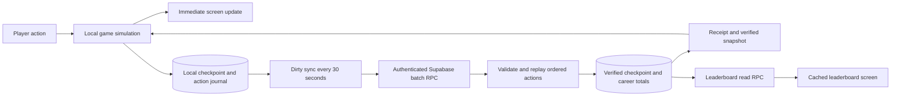

# Local play and global job leaderboards

Status: design and numerical reference, updated 2026-10-12. The approved lifetime/local-first features now have implementation and hosted verification; see [current implementation evidence](../../implementation.md). Historical baseline examples and explicitly labeled future ideas remain reference material, not claims that every optional idea ships.

Related product expansion: [clean Play UI, goals, college, career paths and lifestyle purchases](careers-and-lifestyle.md). That document records the subsequent feature requests and proposes staged delivery; milestones and run history are now planned for the early motivation phase rather than only a distant backlog.

Further requested feature: [customizable public showcases and more wants](possessions-and-showcase.md). Players can select verified qualifications and owned possessions to display; optional overall earnings remain distinct from the career score used for rank.

New gameplay proposal: [lifetime economy, aging and rebirth](lifetime-economy.md) adds a day per completed work/care/study action, age-100 completion and fresh lives. Its shared four-day-actions-per-second allowance replaces the work-only starting assumption below when this economy is adopted. All new formulas remain unimplemented.

## The experience

Progress is solo. Competition happens through global leaderboards: see other players' names, current jobs, and verified career earnings. There are no shared runs, PvP battles, or requests to Supabase for each tap.

Tap Work → money and needs change immediately → progress is saved on the device → Supabase periodically verifies a batch → verified earnings appear on the leaderboard.

Confirmed decisions:

- Hunger drops only through actions; hunger at zero ends a run. Sanity is nonfatal.
- Keep the warm cream, dark text, and muted green visual direction.
- Each job ranks players by **lifetime money earned while doing that job**, across runs.
- Spending money and dying do not reduce career earnings. Switching jobs does not transfer earnings between boards.
- Plan this feature before implementing it.

Recommended defaults below remain proposals: 30-second sync, all-time boards, top 50 entries, and a bounded disconnection window.

## Feature scope

| First release | Later ideas | Separate product decisions |
| --- | --- | --- |
| Instant local work, food, rest, purchases and job changes | Weekly or monthly seasons | Trading and shared economy |
| Durable local save and recoverable sync journal | Friends and small private leagues | PvP or cooperative play |
| Four global career boards | More job paths and college degrees | Real-money purchases |
| Public nickname and preset avatar | Housing, vehicles, businesses and prestige | Unlimited offline ranked play |
| My position, top players and last refresh time | Overall lifetime board | Chat and player-generated content |
| Recoverable account before publicly competing | Seasonal rewards that preserve fair competition | Background/passive earnings |
| Clean Play UI, one tracked goal, milestones and run history | Richer personal best notifications | Full home decoration |

Account linking should precede a public launch: an anonymous session can support a trial, but reinstalling or losing that session must not be the only way to lose a ranked identity. Use an explicitly linked account for recoverable public participation. Keep current guest onboarding available while designing that flow.

## What counts toward a board

Only work payouts increase career earnings. Credit the payout after the sanity multiplier, before spending. Food, equipment, rest, upgrades, refunds and future gifts do not count as earnings. A work action that causes hunger death still credits its final payout under the existing rules.

Example: a player earns 150 begging, spends 100 on a bike, then earns 600 delivering newspapers. Their begging score is 150 and newspaper score is 600, regardless of their remaining wallet. A later death leaves both scores intact.

A player can appear on several boards. A row's career label identifies the board being viewed; its current-job label can differ. Display this distinction clearly: “Newspaper earnings: 600 · Currently: Courier.” Players with zero earnings in a career do not enter that board.

Use all-time rankings initially. Equal scores share a rank; a stable public player ID orders tied rows for pagination. Show top 50 and the signed-in player's verified score and position even when outside that list. Do not run one rank-count query per visible row. Benchmark the own-position query and introduce cached ranks when population warrants it.

## Architecture proposal

Local storage is the immediate save and recovery mechanism. Supabase remains the authority for competitive earnings. Uploading an arbitrary money total would allow an edited local save to become a ranked score, so sync must send ordered actions for validation rather than trusting absolute balances.

This changes the current cloud flow substantially. Today the client buffers work for about 650 ms and waits for server-confirmed economic state. The proposal predicts and saves gameplay locally, then reconciles with periodic server verification. Existing local practice mode does not automatically provide this ranked protocol.

### Local simulation and durable saves

Keep a verified checkpoint, a versioned rules catalog, an ordered action journal, and a derived local snapshot. Work, care, purchases, upgrades, job changes, death and restart all use the same local rules immediately. They do not independently trigger a network call.

Use a transactional local store on native devices for journal/checkpoint consistency. Audit the existing SQLite key-value adapter before choosing whether it can meet the transaction requirements. Web needs a storage adapter with equivalent recovery semantics; localStorage alone is not an atomic multi-record database. No new dependency is selected by this plan.

Render immediately and serialize local persistence. If writes are coalesced for performance, document the maximum unsaved interval and distinguish saving from saved; do not promise zero loss after a forced termination. Benchmark sustained tapping on a physical phone before settling the write strategy.

Use exact integer money arithmetic and the existing decimal-string wire format. Persist before acknowledging that a batch is safely queued. On launch, restore the checkpoint and replay its journal instead of replacing newer local progress with an older cloud snapshot.

### Random payouts must match

The current server samples begging payouts. Instant local prediction requires a versioned deterministic payout algorithm that both client and server reproduce from a server-issued seed and monotonic action counter. Persist the counter; restart or retry cannot reroll a payout. Bind the seed, catalog and counters to the ranked session.

The seed is not a secret and does not prove a human tapped. Server validation enforces legal progression and earning limits; automation remains a separate fairness concern. Never accept client-supplied payout amounts. Prove client/server parity with shared test vectors before enabling rankings.

### Sync schedule and retry behavior

- Start with a 30-second timer while foregrounded. Submit only if there are new actions. Do not debounce indefinitely while the player keeps tapping.
- Keep at most one sync request in flight. New actions append to a separate unsent tail.
- Attempt a coalesced save when leaving the app or returning online. Mobile background termination can prevent completion; recovery must not rely on that attempt.
- Offer one manual “Sync now” control on the leaderboard/account screen, with throttling.
- Death and restart remain locally immediate and journaled in order. A coalesced priority sync can run at a run boundary, subject to a cooldown. It must not become a per-action request.
- Back off on failures. Persist a frozen request ID, base revision, sequence range and payload before sending. Retry that exact envelope until its outcome is known.
- Apply the returned verified checkpoint and acknowledgement atomically, then replay the unsent tail. Never overwrite the tail with the response or create a new ID for an uncertain request.

Ordinary leaderboard updates therefore trail play by roughly one sync interval plus read-cache time. Describe them as periodically updated, not live per-tap scores.

### Server validation and request limits

Introduce a versioned sync contract conceptually containing session ID, request ID, base revision, sequence range, catalog version and ordered actions. The response returns acknowledged sequence, verified snapshot, career totals and server time. Final RPC names and payload schemas belong to implementation design.

Process a valid batch in one transaction: authenticate ownership, lock the session/run, enforce revision and sequence, replay actions, update career totals, and record a receipt. An exact retry returns the previous result. A reused ID with different content fails. Preserve ordered death/restart transitions and reject illegal purchases or actions after death; define any accepted-prefix response precisely so the client can reconcile it.

The current arrival-time rate bucket cannot simply be reused: 120 legitimate actions arriving together after 30 seconds would look like a burst. Validate cumulative work allowance against **server-measured elapsed time** from an issued checkpoint/session, with a small carried burst and bounded accrual. Do not trust client timestamps as proof. Keep the existing four-work-actions-per-second rate as a starting balance assumption, subject to playtesting.

Proposed initial bounds: at most 512 decoded actions and 64 KiB per batch, with explicitly bounded work-count compression that preserves ordering around care, purchases and job changes. Validate compressed counts before expansion. These values need benchmarks, including non-work actions and multi-run batches. At a backlog limit, pause ranked mutations and offer sync/recovery; do not allow an unbounded journal or fire a request for every additional tap.

### Disconnections and multiple devices

Local-first does not require unlimited offline competitive play. Recommend allowing a short interruption, initially five minutes of unsynced ranked play. After that, pause new ranked mutations while retaining pending progress and retrying sync. Hunger never drops just because the connection is lost.

The server must enforce a bounded earning allowance for that window even if an edited client ignores the pause. Permit late delivery of a valid bounded journal after reconnecting; expiration must not automatically discard legitimate pending actions. Specify session issuance, allowance accrual, acknowledgement and renewal together before implementation. The exact disconnection policy is still a product proposal.

Independent local practice can remain available, but practice money, equipment and payouts must never merge into a ranked career. Keep the modes' saves separate and label them clearly.

Allow one active ranked writer session per account. A second device can view boards, then explicitly take over play. Resolve or clearly explain pending progress before takeover. Do not merge two devices' absolute balances or use last-write-wins; purchases, death and payout counters depend on action order. Design recovery for stale sessions before enabling cross-device play.

## Supabase data and access boundaries

Project: `tjegdubzwwgfkcdaufle`. This plan makes no remote changes.

| Conceptual record | Purpose | Access |
| --- | --- | --- |
| Private profile and run | Existing needs, wallet, equipment and lifetime summary | Owner through controlled RPCs |
| Ranked sync session | Writer device, rules/seed, checkpoint, sequence and earning allowance | Owner; server controls issuance |
| Sync receipt | Exact retry result and payload binding | Server-managed |
| Career earnings | Cumulative verified gross payouts per player/job | Server-only writes |
| Public player profile | Public ID, nickname, avatar, field visibility and selected verified showcase references | Validated owner edits through RPC |
| Leaderboard projection | Visible career scores and update time | Bounded authenticated read RPC |

Keep authentication IDs, email, tokens, needs and inventory out of leaderboard responses. Use a separate public player ID. Public participation should require a nickname and an explicit visibility choice; hidden profiles do not appear on boards. Nicknames need length limits, normalization and a basic reporting/moderation policy before public launch.

Extend the existing private schema and grant model instead of introducing direct client writes to economic totals. Any exposed tables require deliberate RLS policies and grants. Database functions need explicit execution permissions and safe ownership/search-path handling. Supabase documents [database functions and RPC](https://supabase.com/docs/guides/database/functions) and [row-level security](https://supabase.com/docs/guides/database/postgres/row-level-security); these support the mechanism, while this document proposes the game-specific design.

Index career rankings by job, visible score descending and stable public ID. Keep career aggregation incremental within the sync transaction rather than re-reading every historical action for a board request. Persist one receipt per batch, not one leaderboard row per tap. Design receipt compaction alongside sequence protection so an old retry cannot credit earnings again.

## Clean leaderboard UI

Add a “Leaders” destination using the existing design tokens. Use four career filters, compact rows with rank/name/earnings, a subtle current-job label, and a pinned “You” row. Highlight the player with muted green; reserve warning colors for actual gameplay warnings. Avoid a second dashboard of decorative statistic cards.

Apply the [showcase plan](possessions-and-showcase.md): current-job visibility is optional, compact selected possessions/credentials can appear in the row, and tapping it opens the fuller public profile. Rank, display name and the selected career's verified score stay visible for public participants.

The Play screen continues to focus on money, hunger, sanity, selected job and Work. Replace the per-action “pending confirmation” message with a quiet aggregate status such as “Saved on device · Rankings synced 30s ago.” Show “Syncing…” only during a request and “Waiting for connection” when relevant. A failed local write needs a different state from a network outage.

Local money changes immediately. The board shows verified earnings, which may temporarily trail the local career total. Explain that difference once near the player's score; do not announce each tap to a screen reader.

Fetch a board on opening, changing to an uncached career, or pull-to-refresh. Start with a 30–60-second cache and at most one automatic refresh per minute while the board is visible. Stop refreshes when it is hidden or backgrounded. Return top entries, my entry and an as-of time together. Preserve cached rows with a stale label when offline.

Do not subscribe every player to every score change initially. Periodic reads fit this product. Realtime can be evaluated later if needed; see Supabase's [Postgres Changes documentation](https://supabase.com/docs/guides/realtime/postgres-changes) for that separate mechanism.

## Network budget and performance

At continuous tapping, a 650 ms dispatch interval permits approximately 92 dispatch opportunities per minute, before request duration and other limits. A 30-second dirty sync targets two gameplay requests per active minute, plus bounded retries, lifecycle syncs and explicit reads. This is roughly 98% fewer gameplay requests under that comparison, not a pricing guarantee or a measurement of current production traffic.

At four work actions per second, each normal 30-second batch contains about 120 work actions plus care/purchases. For 1,000 continuously active players, two batches each minute means about 33 sync requests per second, while the server still validates about 4,000 work actions per second. Fewer requests do not remove simulation CPU cost. Benchmark transaction latency, contention, payload size and own-rank queries before scaling.

Track sync requests per active minute, p95 batch validation time, journal size, retry rate, local/server divergence and leaderboard staleness. Never log credentials or entire private saves for these metrics.

## Implementation sequence for the designated roles

| Step | Owner | Concrete deliverable and exit condition |
| --- | --- | --- |
| 1. Contract and rules | Lead + backend + mobile | Versioned batch/recovery specification; deterministic payout vectors; agreed disconnect and takeover policy |
| 2. Local engine | Mobile developer | Immediate actions, transactional journal, restored saves and bounded persistence latency; no per-action network call |
| 3. Verification and storage | Backend + database developers | Session/sequence validation, retry receipts, server-time allowance, atomic career deltas, migration and RLS review |
| 4. Ranking API | Backend + database developers | Indexed four-career reads with top 50, own position, visibility and stable tie handling |
| 5. Social UI and identity | UI designer + mobile developer | Clean Leaders screen, sync status, nickname/visibility and recoverable account flow |
| 6. Migration and rollout | Lead + all roles | Protocol feature flag, compatibility gate, failure tests, load evidence and staged rollout |

Use the configured role specifications in `.codex/agents/` when implementation is authorized. Relevant installed skills are Expo overview, native UI/design system and Supabase Postgres best practices. Read the matching SDK documentation before touching Expo APIs. This plan does not invoke agents to implement these steps yet.

### Migration from today's saves

Preserve existing wallets, run state and overall lifetime totals. Existing records do not necessarily contain a complete, reliable per-job earnings history. Do not assign all historical earnings to the currently selected job. Recommend starting career-board counters at feature launch and explaining “Career rankings count earnings since launch”; keep legacy overall lifetime earnings separate. Reconstruct history only if an audit proves complete attribution.

Create the first verified checkpoint from current authoritative state. Gate old and new command protocols so they cannot both write the same ranked session. Pin catalog versions across queued batches; reconcile old journals before changing rules. Roll out behind a feature flag and retain an explicit recovery path rather than dropping pending actions on upgrade.

## Acceptance scenarios

- 100 rapid taps update the local screen immediately; ordinary gameplay sends no per-tap requests and syncs at the scheduled boundary.
- A job switch inside a batch attributes payouts before and after the switch to their respective careers.
- Buying food/equipment changes the wallet but never subtracts earned career score.
- Death and a subsequent restart replay in order; lifetime career scores survive both.
- A lost response followed by an exact retry or app relaunch credits earnings once, while actions added during the request remain intact.
- Killing the app during persistence recovers a consistent checkpoint/journal according to the documented durability window.
- Client and server reproduce begging payouts across retries, restarts, low sanity and catalog versions.
- Edited reward amounts, skipped sequence numbers, excessive work counts, wrong owners and stale writer sessions cannot increase verified scores.
- A late valid journal within its bounded allowance survives reconnection; the ranked pause has no time-based hunger penalty.
- Leaderboard ties, hidden profiles, an empty career and a player outside the top 50 render correctly.
- Four boards remain readable on small phones, with large text, screen readers and dark mode.
- Representative load meets an agreed latency budget; lint/typecheck and meaningful engine/database recovery tests pass before release.

## Decisions to settle before coding

1. Approve or tune the proposed 30-second sync interval and five-minute disconnection allowance.
2. Choose the recoverable sign-in method and exact public-profile visibility flow.
3. Confirm whether a second device may take over while the first has pending actions, and what recovery users see.
4. Confirm career scores begin at feature launch unless historical attribution is proven.

The main product decision is already settled: instant solo progression, with periodic verification and independent lifetime leaderboards for each job.
